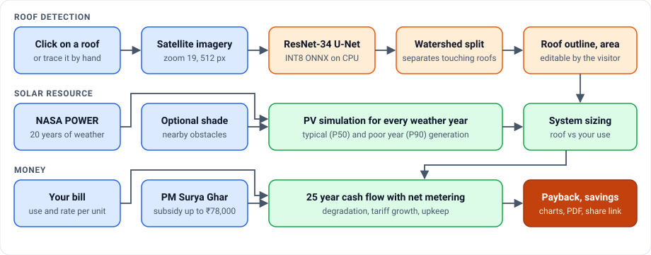

<div align="center">

# ☀️ Rooftop Solar Planner

**Click your roof on a satellite map. A deep learning model outlines it, and 20 years of NASA weather data tell you whether solar is worth it.**

[](https://solar-planner-33mq.onrender.com/planner/)
[](https://github.com/Charan7sai/solar-planner/actions/workflows/ci.yml)


<sub>The live site runs on a free plan, so the first visit after a quiet spell takes about a minute to wake up.</sub>

</div>

## The problem

Most Indian homeowners cannot easily answer a simple question: **should my house go solar?** Installers give quotes, not independent numbers, and online calculators ask for a roof area most people do not know.

This app measures the roof from satellite imagery, simulates a system against the real weather at that spot, and returns the system size, cost after the PM Surya Ghar subsidy, payback period and 25 year savings.

## At a glance

| | |
|---|---|
| **End to end scope** | Dataset, model training, evaluation, backend, frontend, deployment and analytics |
| **Training data** | 21,052 aerial tiles from 15 countries, with validation and test tiles from locations the model never saw |
| **Model** | ResNet-34 U-Net in PyTorch, exported to ONNX with static INT8 quantization |
| **Optimization** | **4× smaller** (97.7 MB to 24.7 MB) with no loss in validation IoU |
| **Inference speed** | 289 ms per 512 px area on 2 CPU threads in the benchmark; 4 to 5.5 s per request on the free plan's 0.1 CPU |
| **Roof accuracy** | **21% median area error** on 300 held-out buildings, reduced from 39% by a watershed post-processing step |
| **Solar data** | 20 years of NASA POWER irradiance and temperature, giving typical (P50) and poor year (P90) generation |
| **Quality** | 58 automated tests, and CI that builds and smoke-tests the Docker image on every push |

## How it works



## Engineering highlights

**1. Model selection that a reviewer can trust.** Checkpoints and thresholds were chosen on validation only. One run scored higher on the test set (0.339 vs 0.321 IoU) but lost on validation, so it was rejected, because choosing by test score would make that score meaningless.

**2. Measuring what users actually see.** Pixel IoU rewards good masks, but a user gets one outline for the roof they clicked. So [`evaluate_detection.py`](ml/evaluate_detection.py) simulates a click on each of 300 held-out buildings and scores the returned polygon. This exposed neighbouring roofs merging into one blob, which led to the watershed step that cut median area error from 39% to 21%.

**3. Built to run on a free CPU.** Quantizing the model made free hosting possible. The whole app peaks at about 194 MB of memory during detection, measured locally, against the plan's 512 MB limit.

**4. An API key that never reaches the browser.** The first version exposed the imagery key in page requests. Map tiles now pass through a server proxy that adds the key and refuses other websites, with tests that fail if the key ever appears in a response or a tracked file.

**5. Privacy by default.** Google Analytics loads only after a visitor accepts. Coordinates are not stored or logged. Share links keep the location to about 1 km and leave out the roof outline.

**6. Honest uncertainty.** The system is simulated against all 20 weather years, not one average, so visitors see both a typical and a poor year. When a location's imagery is old, the app warns that recent buildings may be missing.

## Results

Measured per building on **300 held-out buildings**, simulating a click at the centre of each roof. Post-processing was chosen on validation, then scored once on test.

| Post-processing | Roofs found | Mean IoU | Roofs with IoU > 0.5 | Median area error |
|---|---:|---:|---:|---:|
| Connected components | 67% | 0.326 | 32% | 39% |
| **Watershed split (deployed)** | 65% | **0.378** | **40%** | **21%** |


<sub>Model output (yellow) on six Indian neighbourhoods. Imagery © Esri, Maxar, Earthstar Geographics.</sub>

**How the model improved**

| Stage | Size | Test IoU | Test F1 |
|---|---:|---:|---:|
| U-Net from scratch, 7.76 M parameters | | 0.308 | 0.471 |
| Pretrained ResNet-34 U-Net, 24.4 M parameters | 97.7 MB | **0.321** | **0.486** |
| Same model, INT8 ONNX (deployed) | **24.7 MB** | Validation IoU unchanged (0.502 to 0.504) | |

Test IoU ranges from 0.65 in Mozambique to 0.12 in Peru, whose rooftops look unlike the training data. The full write-up, with training curves and per-country results, is in the **[model report](ml/README.md)**.

## The estimate

| Step | Method |
|---|---|
| **Sizing** | 10 m² per kW on 75% of the roof, capped at what your use needs |
| **Generation** | kW × sunlight × days × a performance ratio that falls 0.4% per °C above 25 °C cell temperature |
| **Shade** (optional) | Sun position every 15 minutes through a typical day of each month against the height and distance you enter, with NASA's diffuse light share |
| **Subsidy** | PM Surya Ghar, the same across India: ₹30,000 per kW for 2 kW, ₹18,000 for the third, capped at ₹78,000 |
| **Cash flow** | 25 years of net metering: surplus offsets later months and the year end balance earns the export rate, with 0.5% panel degradation, 3% tariff growth and 1% upkeep a year |

## Tech stack

| Area | Tools |
|---|---|
| **Machine learning** | PyTorch, torchvision, ONNX, ONNX Runtime, OpenCV (watershed), NumPy |
| **Backend** | FastAPI, Pydantic, httpx, Uvicorn |
| **Frontend** | JavaScript, Leaflet, Leaflet.draw, Chart.js, responsive CSS with light and dark themes |
| **Data** | HOT Building Segmentation, NASA POWER, ArcGIS World Imagery, OpenStreetMap Nominatim |
| **Delivery** | Docker, GitHub Actions, Render, HTTPS, Content Security Policy |
| **Quality and growth** | pytest, Playwright release checks in Chromium and WebKit, Google Analytics, Search Console |

## Known limitations

Knowing where a system fails matters as much as its best numbers.

- **Detection misses about a third of roofs**, especially in dense, uniformly grey flat-concrete areas, and can merge touching buildings. Every outline can be edited, or the roof traced by hand.
- **Bills use one flat rate.** State slabs, duty, surcharges and each power company's net metering rules are not modelled, because they could not all be verified from official sources.
- **Shade depends on what a visitor enters** and treats the roof as one point.
- **This is an estimate, not a quote.** The site tells visitors to get a survey from an installer before buying.

## Run it locally

```bash
git clone https://github.com/Charan7sai/solar-planner.git
cd solar-planner
pip install -r requirements.txt
uvicorn app.main:app --reload    # open http://localhost:8000
```

Without a key, the app falls back to OpenStreetMap and manual tracing. For satellite imagery and roof detection, get a free [ArcGIS Location Platform](https://location.arcgis.com) key with Basemaps access and put it in a `.env` file, which git ignores:

```bash
echo "ARCGIS_API_KEY=<your key>" > .env
```

Run the tests:

```bash
pip install pytest && python -m pytest
```

<details>
<summary><strong>Optional settings</strong></summary>

| Setting | Needed for |
|---|---|
| `ARCGIS_API_KEY` | Satellite map, roof detection and imagery dates |
| `GA_MEASUREMENT_ID` | Google Analytics, loaded only after a visitor accepts the cookie notice |
| `GOOGLE_SITE_VERIFICATION` | Search Console's HTML file check |
| `SITE_URL` | Public address for the sitemap, if it should not come from the request |

</details>

<details>
<summary><strong>Deploy your own on Render</strong></summary>

1. Create a **Web Service** from this repo. Render finds the `Dockerfile` by itself.
2. Choose the **Free** instance type and add your settings under **Environment**.
3. Each push to `main` then deploys again, with HTTPS included.

Free services sleep after 15 minutes without visitors.

</details>

<details>
<summary><strong>API</strong></summary>

`POST /api/detect-roof` returns the roof under a point as GeoJSON:

```json
{ "lat": 17.415234, "lon": 78.434525 }
```
```json
{ "found": true, "area_m2": 252.4, "confidence": 0.93,
  "polygon": { "type": "Polygon", "coordinates": [[[78.4344, 17.4153]]] } }
```

`POST /api/estimate` returns sizing, generation and the 25 year cash flow:

```json
{ "lat": 17.385, "lon": 78.486, "roof_area_m2": 60, "monthly_units": 300,
  "tariff": 7, "export_rate": 3, "cost_per_kw": 60000,
  "obstacles": [{ "direction": "S", "height_m": 8, "distance_m": 6 }] }
```

</details>

<details>
<summary><strong>Reproduce the model</strong></summary>

The dataset download, training commands and evaluation steps are in the [model report](ml/README.md#reproduce). Training the baseline took 106 minutes on an RTX 3050 laptop GPU.

</details>

## Project structure

```
app/        FastAPI backend: roof detection, solar model, shading, finance, tile proxy
ml/         Data preparation, training, evaluation, ONNX export and the model report
models/     The deployed INT8 ONNX model
static/     Landing page and planner frontend
tests/      Unit and API tests
docs/       Demo GIF
```

The project was built in six tested [checkpoints](CHECKPOINTS.md), from the first physics model to live deployment. Each one is tagged in git.

## What's next

- More diverse training data for dense flat-roof neighbourhoods
- Building heights from data, so shade no longer has to be entered by hand
- A yield correction learned from real inverter data
- State tariff slabs and each power company's net metering rules

## Credits

Data from [NASA POWER](https://power.larc.nasa.gov/) and the [HOT Building Segmentation](https://huggingface.co/datasets/hotosm/vhr-building-segmentation) dataset (imagery CC-BY-4.0, labels ODbL). Imagery © Esri, Maxar, Earthstar Geographics. Address search by [OpenStreetMap](https://www.openstreetmap.org/copyright) contributors.

## Author

**Charan Sai Neelisetty**

[LinkedIn](https://www.linkedin.com/in/charan-sai-neelisetty-616021328/) · [GitHub](https://github.com/Charan7sai) · [Email](mailto:neelisettycharansai@gmail.com)
