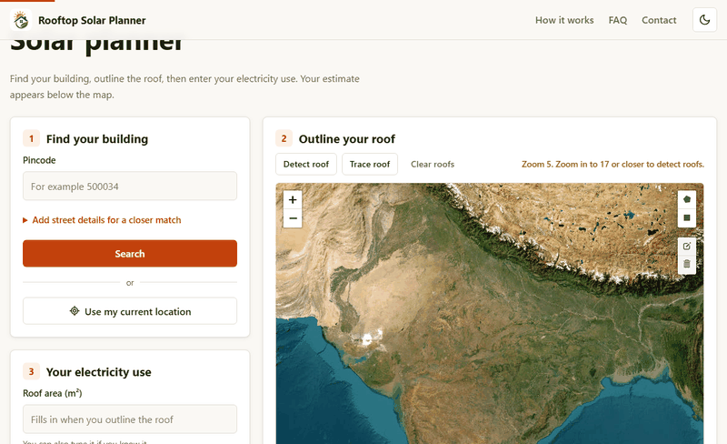
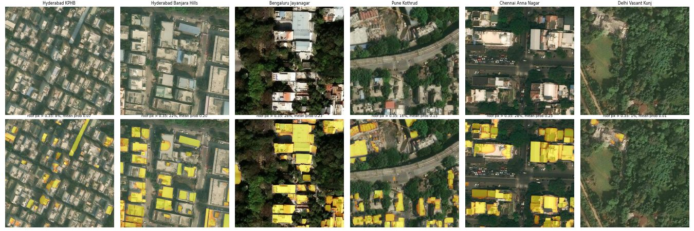

# Rooftop Solar Planner

**Live site: [solar-planner-33mq.onrender.com](https://solar-planner-33mq.onrender.com)** (free hosting: the first visit after a quiet spell takes about a minute to wake up).

Should *my* house go solar? **Click your roof on the satellite map and a deep-learning model outlines it**, then enter your electricity bill to get a system size, cost after the **PM Surya Ghar** subsidy, payback period and 25-year savings. Generation comes from **20 years of NASA POWER satellite data** for your exact coordinates.


*Imagery © Esri, Maxar, Earthstar Geographics.*

## How it works

```
Click on roof ─▶ zoom-19 imagery (512 px) ─▶ ResNet-34 U-Net, INT8 ONNX on CPU
                                                  │
                     watershed split of touching roofs ─▶ roof polygon + area (m²)
                                                          │   (editable; manual tracing also works)
NASA POWER (2004–2023 monthly irradiance + temperature) ──┤
                                                          ▼
                       PV model: kWp × GHI × days × PR(temperature)
                                                          │
             ┌────────────────────────────────────────────┼──────────────────────────┐
             ▼                                            ▼                          ▼
   Sizing (roof vs. consumption)        P50 / P90 annual generation        25-yr cash flow
                                       (spread over 20 real weather years)  (net metering, subsidy,
                                                                            degradation, tariff escalation)
```

- **Sizing:** 10 m² of shadow-free roof per kWp, 75% of the roof usable, capped at what your consumption needs.
- **Generation:** a temperature-derated performance ratio (−0.4%/°C above 25 °C cell temperature). The system is simulated against every historical year, so you get both a typical (P50) and a bad-year (P90) figure, not a single guess.
- **Finance:** net metering with a month's surplus banked for later months and the year-end balance paid at the export rate, 0.5%/yr panel degradation, 3%/yr tariff escalation, 1%/yr maintenance.
- **Subsidy:** central financial assistance under PM Surya Ghar, the same across India: Rs 30,000/kW for the first 2 kW and Rs 18,000 for the third, capped at Rs 78,000. State subsidies are not included.
- **Tariff:** one flat rate per unit from the visitor's bill. Slabs, duty and surcharges differ by state and are not modelled.
- **Shade (optional):** enter the height and distance of anything taller than your roof to the south, east, west or north. The sun's path is stepped every 15 minutes through a typical day of each month, and NASA's diffuse sunlight share sets how much light still gets through. It treats the roof as one point, so partial shade across the panels is not modelled.

## Roof detection

The model ([training and evaluation](ml/README.md)) was trained on 21k aerial tiles from
15 countries and runs on CPU as a 24.7 MB INT8 ONNX file in about 0.3 s per click.
Measured per building on 300 held-out roofs, with the user simulated clicking the roof centre:

| Post-processing (chosen on validation) | Mean IoU | Roofs with IoU > 0.5 | Median area error |
|---|---|---|---|
| Plain connected components | 0.326 | 32% | 39% |
| **Watershed split of touching roofs** | **0.378** | **40%** | **21%** |

On Esri imagery of Indian cities it separates individual roofs well in mixed neighbourhoods
(Banjara Hills, Jayanagar, Kothrud, Anna Nagar), but misses many roofs in very dense,
uniformly grey flat-concrete areas (e.g. KPHB). You can always edit the outline or trace it yourself.


*Model output (yellow) on six Indian neighbourhoods. Imagery © Esri, Maxar, Earthstar Geographics.*

## Run locally

Satellite imagery and roof detection need a free
[ArcGIS Location Platform](https://location.arcgis.com) API key (public application, **Basemaps**
privileges only). Without a key the app falls back to OpenStreetMap and manual tracing.

```bash
pip install -r requirements.txt
echo "ARCGIS_API_KEY=<your key>" > .env   # .env is git ignored
uvicorn app.main:app --reload
# open http://localhost:8000
```

The key stays on the server: map tiles reach the browser through `/api/tiles`, which adds the key
and only serves this site's own pages.

| Setting | Needed for |
|---|---|
| `ARCGIS_API_KEY` | Satellite map, roof detection and imagery dates |
| `GA_MEASUREMENT_ID` | Google Analytics (`G-...`), loaded only after a visitor accepts the cookie notice |
| `GOOGLE_SITE_VERIFICATION` | Search Console's HTML file check, e.g. `google1234abcd.html` |
| `SITE_URL` | Optional public address for the sitemap, e.g. `https://example.onrender.com` |

```bash
pip install pytest && python -m pytest
```

## Deploy free on Render

1. Sign up at [render.com](https://render.com) with GitHub and create a **Web Service** from this repo. Render finds the `Dockerfile` by itself.
2. Choose the **Free** instance type and add `ARCGIS_API_KEY` and any other settings from the table above under **Environment**.
3. The app is live with HTTPS at `https://<name>.onrender.com`, and each push to `main` deploys again.

Free services sleep after 15 minutes without visitors, and the next visit takes about a minute to wake them.

## Pages

| Path | What it is |
|---|---|
| `/` | Landing page: how it works, accuracy and limits, FAQ, contact |
| `/planner/` | The planner: pincode or current-location search, roof detection, estimate with charts |
| anything else | Custom 404 page |

Light and dark themes (remembered per browser), a print stylesheet for saving the estimate as a PDF,
a share link that keeps the location to about 1 km and leaves out the roof outline,
and Google Analytics only for visitors who accept the cookie notice.

### Campaign tracking (UTM)

Add UTM parameters to links you share, for example
`https://<your-site>/?utm_source=linkedin&utm_medium=social&utm_campaign=launch`.
The parameters are kept for the browser tab and sent with anonymous usage events
(`page_view`, `search`, `location_used`, `roof_detected`, `estimate`, ...) to `POST /api/track`,
which writes one JSON line per event to the server log. Events never include coordinates or addresses.

## API

`POST /api/detect-roof` returns the roof under a point as GeoJSON:

```json
{ "lat": 17.415234, "lon": 78.434525 }
→ { "found": true, "area_m2": 252.4, "confidence": 0.93,
    "polygon": { "type": "Polygon", "coordinates": [[[78.4344, 17.4153], …]] } }
```

`POST /api/estimate`

```json
{ "lat": 17.385, "lon": 78.486, "roof_area_m2": 60, "monthly_units": 300,
  "tariff": 7, "export_rate": 3, "cost_per_kw": 60000,
  "obstacles": [{ "direction": "S", "height_m": 8, "distance_m": 6 }] }
```

## Roadmap

- [x] **Roof segmentation baseline:** U-Net on 21k aerial tiles, 0.308 test IoU on unseen locations ([details](ml/README.md))
- [x] **Pretrained model + CPU export:** ResNet-34 U-Net, 0.321 test IoU, INT8 ONNX (24.7 MB, <0.3 s per area)
- [x] **Drop-a-pin roof detection:** click a roof to get an editable outline and area (0.378 instance IoU, 21% median area error)
- [ ] **More diverse training data** for dense flat-roof neighbourhoods (KPHB, Peru-style)
- [x] **Shading estimate:** losses from the height and distance of nearby buildings and trees you enter
- [ ] **Automatic shading:** read building heights from data instead of asking
- [ ] **Learned yield correction:** train on real inverter data to correct the physics model
- [x] Banked net metering with the PM Surya Ghar subsidy
- [ ] State tariff slabs and each DISCOM's own net metering rules
- [x] Shareable estimate link and PDF
