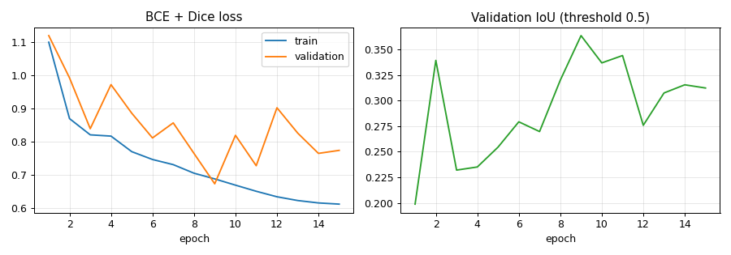
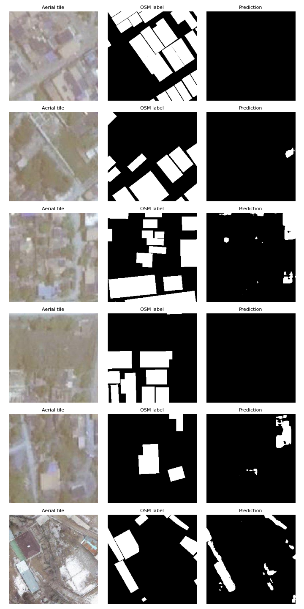
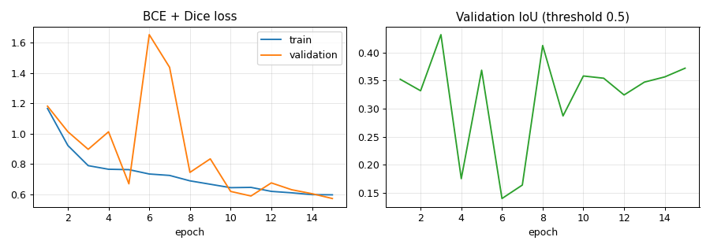

# Roof segmentation model

Goal: given a satellite tile of a neighbourhood, mark which pixels are rooftops. The planner can
then measure usable roof area from a single pin drop instead of asking users to trace the roof.

## Data

[HOT Building Segmentation](https://huggingface.co/datasets/hotosm/vhr-building-segmentation)
(Humanitarian OpenStreetMap Team; imagery CC-BY-4.0, labels ODbL): 256×256 aerial tiles at
zoom 19 (~0.3 m/pixel) from OpenAerialMap with expert-validated OpenStreetMap building masks.

- Zoom 19 matches the satellite map used by the app, so tiles can be fed to the model directly.
- Mostly informal and peri-urban settlements in the Global South, closer to Indian
  neighbourhoods than US/European benchmarks.
- **Splits are by mapping project**, so validation and test tiles come from locations the model
  never saw. Scores therefore measure generalisation to new places, not memorisation.

| Split | Tiles | Countries |
|---|---|---|
| Train (4 of 11 shards) | 21,052 | 15 (Myanmar, Mozambique, Mexico, Kenya, …) |
| Validation | 7,237 | 3 |
| Test | 7,236 | 6 (Eswatini, Peru, Japan, Mozambique, Tajikistan, Philippines) |

## CP2 baseline: U-Net from scratch

| | |
|---|---|
| Architecture | U-Net, 4 levels, base width 32, BatchNorm, 7.76 M parameters |
| Loss | BCE + soft Dice (counters the background/building imbalance) |
| Training | AdamW, OneCycle LR (max 1e-3), batch 16, mixed precision, 15 epochs |
| Augmentation | 8 dihedral flips/rotations, brightness/contrast jitter |
| Hardware | RTX 3050 Laptop GPU (4 GB), 106 min |

### Results

Pixel-level metrics, micro-averaged over each split. The best epoch (9) was selected by
validation IoU. The decision threshold was tuned on **validation only** and then applied
unchanged to test.

| Split | Threshold | IoU | F1 | Precision | Recall |
|---|---|---|---|---|---|
| Validation | 0.5 | 0.364 | 0.533 | 0.755 | 0.412 |
| Validation | 0.1 (tuned) | 0.454 | – | – | – |
| **Test** | 0.5 | 0.283 | 0.441 | 0.610 | 0.346 |
| **Test** | 0.1 (tuned) | **0.308** | **0.471** | 0.468 | 0.474 |

Test IoU by country (tuned threshold):

| Country | Tiles | IoU | F1 |
|---|---|---|---|
| Philippines | 70 | 0.606 | 0.755 |
| Mozambique | 1,296 | 0.600 | 0.750 |
| Japan | 1,307 | 0.464 | 0.634 |
| Tajikistan | 791 | 0.421 | 0.593 |
| Eswatini | 2,376 | 0.265 | 0.419 |
| Peru | 1,396 | 0.123 | 0.219 |




### What we learned

- **It generalises unevenly.** On imagery similar to training (Mozambique, Philippines) it reaches
  ~0.60 IoU. On Peru, whose roof materials and building density differ from anything in
  training, it drops to 0.12.
- **It's under-confident.** At 0.5 it has high precision but low recall. The best validation
  threshold is 0.1, which suggests the Dice term pushes probabilities down. Calibrating the
  outputs or using a lower threshold recovers recall.
- **Validation is noisy** (0.23–0.36 between epochs) because three locations dominate it.
  Selecting the checkpoint by validation IoU is still better than taking the last epoch.
- **Some labels are noisy.** Some test tiles are blurry or the OSM outlines are offset from the
  imagery, which caps the achievable IoU (see the first rows of the prediction grid).

These results motivated CP3: try an ImageNet-pretrained encoder.

## CP3: pretrained encoder + CPU-ready export

### Pretrained ResNet-34 encoder

Same data, augmentation, loss, epochs and evaluation protocol as the baseline, so the only change
is the model. The decoder upsamples ResNet-34 features (ImageNet weights from torchvision) back to
full resolution with U-Net skip connections: 24.4 M parameters, and *faster* per step than the
baseline (0.15 s vs 0.21 s) because less work happens at full resolution.

**Selection protocol:** for every run, `evaluate.py` compares the best-by-IoU@0.5 and last-epoch
checkpoints and sweeps the threshold, **all on validation**. Only the winner is scored on test.
The final model is the run with the highest validation IoU.

| Run | LR | Selected | Threshold | Val IoU | Test IoU | Test F1 |
|---|---|---|---|---|---|---|
| U-Net from scratch (CP2) | 1e-3 | epoch 9 | 0.10 | 0.454 | 0.308 | 0.471 |
| **ResNet-34 U-Net** ✅ | 5e-4 | epoch 3 | 0.20 | **0.501** | **0.321** | **0.486** |
| ResNet-34 U-Net | 2e-4 | epoch 15 | 0.05 | 0.494 | 0.339 | 0.506 |

The 2e-4 run scored better **on test**, but it lost on validation, so it was not chosen. Picking
a model by its test score would make the test number meaningless. Both pretrained runs beat the
baseline on validation and test, and the gap between them is within run-to-run noise.

Test IoU by country:

| Country | Baseline | ResNet-34 (selected) |
|---|---|---|
| Mozambique | 0.600 | **0.651** |
| Philippines | 0.606 | 0.522 |
| Japan | 0.464 | 0.451 |
| Tajikistan | 0.421 | **0.450** |
| Eswatini | 0.265 | **0.330** |
| Peru | 0.123 | 0.125 |



**What we learned:**
- The pretrained encoder reaches the baseline's best validation IoU **within one epoch** and gains
  most on Eswatini (+25% relative) and Mozambique.
- **Peru remains unsolved** (~0.12 for every model). Its rooftops look unlike anything in the
  training data, so this needs more diverse data (e.g. adding similar regions), not a bigger model.
- Validation IoU at a fixed 0.5 threshold swings a lot between epochs for every run, while
  validation loss falls steadily. The models' calibration drifts against the unseen validation
  locations, which is why tuning the threshold on validation matters.

### ONNX export + INT8 quantization

Free hosting is CPU-only, so `export_onnx.py` exports the
selected model to ONNX (dynamic height/width), checks it against PyTorch, applies **static INT8
quantization** (per-channel weights, calibrated on 256 validation tiles), and benchmarks it on
1,000 *other* validation tiles.

| | Size | Val IoU | CPU, 2 threads, 256 px | CPU, 2 threads, 512 px |
|---|---|---|---|---|
| PyTorch FP32 | 97.7 MB | 0.502 | – | – |
| ONNX FP32 | 97.7 MB | 0.502 | 83 ms | 340 ms |
| **ONNX INT8** | **24.7 MB** | **0.504** | **76 ms** | **289 ms** |

ONNX output matches PyTorch to within 3e-5. Quantization makes the model **4× smaller with no loss
in accuracy**, and a 512 px area (about one city block at zoom 19) is segmented in under 0.3 s.

## CP4: from masks to one roof per click

Pixel IoU rewards good masks, but users get **one outline for the roof they clicked**. With the
pixel-optimal threshold (0.2), neighbouring roofs and paved areas merge into one blob, so
`evaluate_detection.py` measures what users actually see: it simulates a click at the centre of
300 held-out buildings and compares the returned polygon with that building's label.

Post-processing candidates were compared on **validation** buildings:

| Method | Val mean IoU | Val median area error |
|---|---|---|
| Components @ 0.2 | 0.312 | 99% |
| Components @ 0.5 | 0.372 | 39% |
| Components @ 0.65 | 0.375 | 34% |
| Watershed 0.2 / 0.5 | 0.383 | 44% |
| **Watershed 0.35 / 0.65** | **0.403** | **33%** |

The watershed seeds a region from every high-confidence (>0.65) roof core and lets the seeds grow
through the >0.35 mask, so touching roofs split where confidence dips between them. On **test**:

| | Found | Mean IoU | IoU > 0.5 | Median area error |
|---|---|---|---|---|
| Components @ 0.2 | 67% | 0.326 | 32% | 39% |
| **Watershed 0.35 / 0.65** | 65% | **0.378** | **40%** | **21%** |

Results are in [`runs/detection_eval.json`](runs/detection_eval.json).

## Reproduce

```bash
pip install torch==2.7.1+cu126 torchvision==0.22.1+cu126 --extra-index-url https://download.pytorch.org/whl/cu126
pip install -r ml/requirements.txt
python ml/prepare_data.py                          # ~3.7 GB download
cd ml
python train.py --run unet_baseline --epochs 15    # add --resume to continue an interrupted run
python evaluate.py --run unet_baseline

python train.py --arch resnet34_unet --lr 5e-4 --run resnet34_unet --epochs 15
python evaluate.py --run resnet34_unet
python export_onnx.py --run resnet34_unet          # needs: pip install onnx onnxruntime onnxscript
cd ..
python ml/evaluate_detection.py --buildings 300     # per-building evaluation of the deployed pipeline
```
